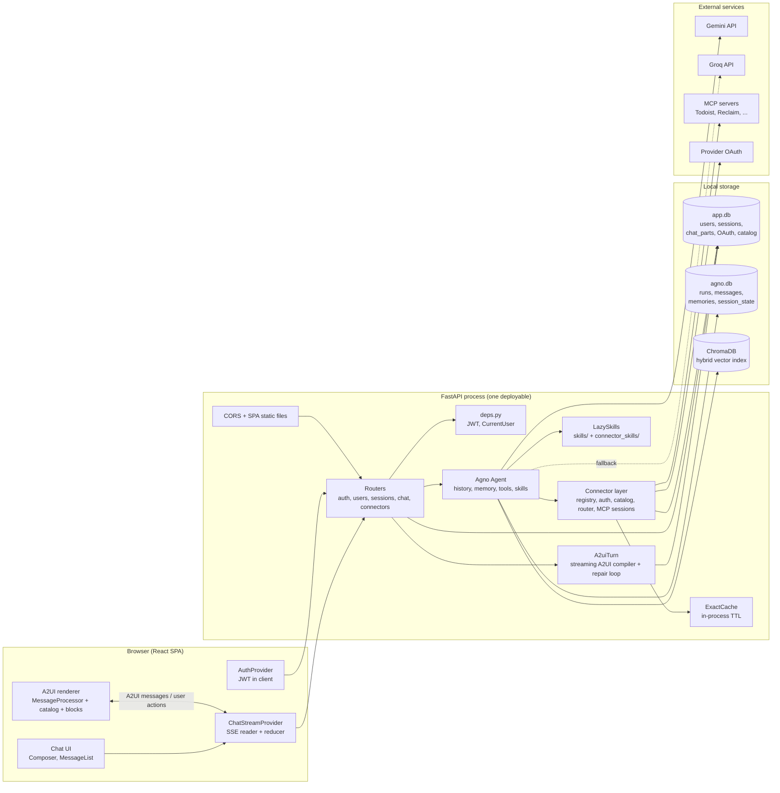
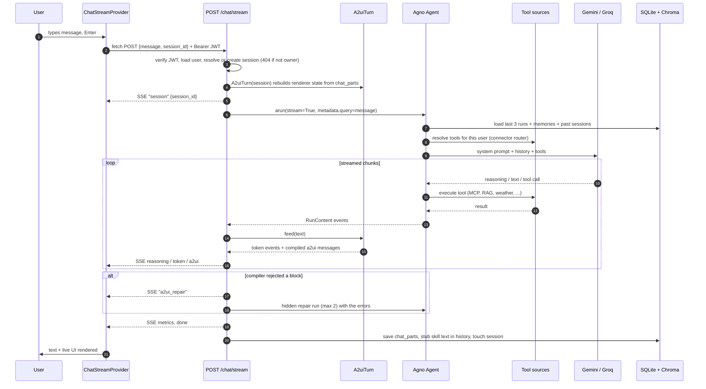
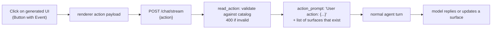
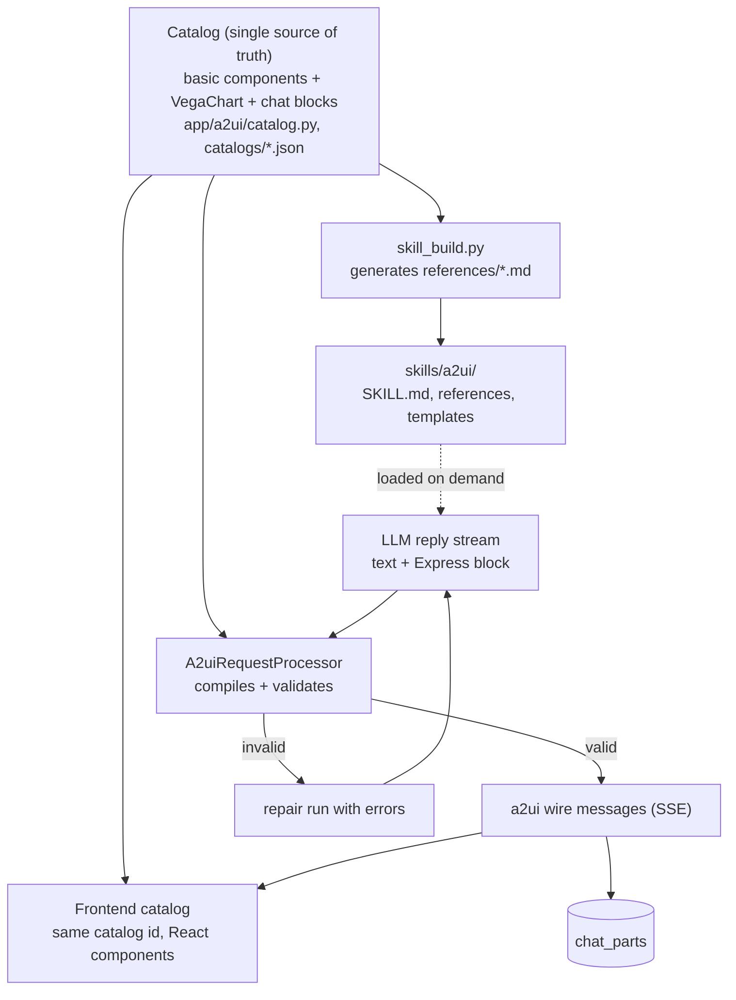
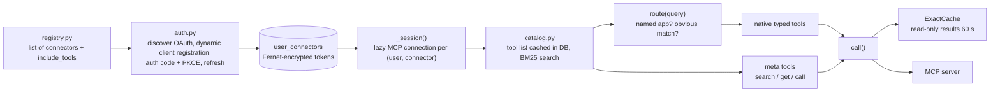
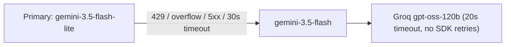

# Dots-in Chat: Architecture

A guide to how the chatbot in `dots-in-chat/` is built, how a user's message travels through it,
and why it is built this way. Every claim points at a file, so you can read the code alongside.

## 1. What the system is

A multi-user chat app where an LLM agent can answer questions, search the user's documents, call
tools (including the user's own connected apps such as Todoist), and **draw interactive UI**
(forms, charts, calculators) inside its replies.

| Layer | Tech | Lives in |
|---|---|---|
| Frontend | React, Vite, Tailwind v4, TanStack Query | `dots-in-chat/frontend/src/` |
| API | FastAPI (async) | `dots-in-chat/app/` |
| Agent runtime | Agno `Agent` | `app/agent.py` |
| LLMs | Gemini (primary) with Groq as fallback, or the reverse | `app/agent.py`, `app/config.py` |
| Storage | SQLite (app + agent), ChromaDB (vectors) | `data/` |
| External tools | MCP servers over OAuth (Todoist, Reclaim, ...) | `app/connectors/` |
| Generative UI | A2UI protocol (agent writes UI, browser renders it) | `app/a2ui/`, `frontend/src/features/chat/a2ui/` |

## 2. System blocks

The backend is **one process** that also serves the built frontend (`app/main.py`:
`SPAStaticFiles` falls back to `index.html` for client-side routes, but keeps 404s for API paths
and missing assets). In development, Vite proxies the API prefixes to `:8000`
(`frontend/vite.config.ts`).

### Block responsibilities

| Block | Responsibility | Key files |
|---|---|---|
| **Auth** | Signup, login (OAuth2 password form), argon2 hashes, 60-min JWT, `CurrentUser` dependency | `routers/auth.py`, `security.py`, `deps.py` |
| **Sessions** | Chat list, ownership checks, history replay | `routers/sessions.py`, `db.py` |
| **Chat** | The streaming endpoint; orchestrates one turn | `routers/chat.py` |
| **Agent** | LLM loop: prompt, history, memory, tools, fallback | `agent.py` |
| **Skills** | Task playbooks loaded on demand instead of living in the system prompt | `skills.py`, `skills/`, `connector_skills/` |
| **A2UI** | Catalog, streaming compiler, repair, surface persistence | `app/a2ui/` |
| **Connectors** | OAuth, MCP connections, tool catalog, tool routing, result cache | `app/connectors/` |
| **Knowledge (RAG)** | Hybrid search over the user's documents | `agent.py`, `ingestion.py` |
| **Guardrails** | PII, length, output checks, tool timing | `guardrails.py` (the input/output hooks are currently disabled in `agent.py`) |

## 3. The path of one user query

This is the main flow: the user types a message and a reply streams back.

### Step by step

1. **Frontend sends.** `ChatStreamProvider.send()` calls `api.openChatStream`, a `fetch` POST (not
   `EventSource`, because it must carry the `Authorization` header). A typed message is
   `{message}`; a click on a generated UI is `{action}`.
2. **Auth.** `get_current_user` decodes the JWT, then still queries the DB, so a token for a
   deleted user fails (`deps.py`).
3. **Session.** `resolve_session` creates a session if none was sent, or enforces that the given
   one belongs to this user (`routers/chat.py`).
4. **Turn setup.** `A2uiTurn` replays every stored A2UI message of the session, so the model can
   later update or delete surfaces from earlier turns (`a2ui/turn.py`, `a2ui/store.py`).
5. **Agent run.** `agent.arun(..., stream=True)` with `metadata.query` set to the message. That
   metadata is what the connector router reads to pick tools.
6. **Context assembly (Agno).** System instructions, the last 3 runs of history, agentic memories,
   up to 8 past sessions searchable, current datetime, and the skill index (`agent.py`).
7. **Tool resolution.** `agent_tools` runs on every run (`cache_callables=False`) and returns
   shared tools plus this user's connector tools (section 5).
8. **Model call** goes to the primary LLM; on rate limit, context overflow or 5xx, Agno
   switches to the next model in the chain (section 6).
9. **Streaming out.** Each text chunk goes through `A2uiTurn.feed`. Plain prose becomes `token`
   events. A finished A2UI statement becomes an `a2ui` event, so UI appears progressively.
   Gemini/Groq thoughts become `reasoning` events (shown as "Thinking").
10. **Repair loop.** If the compiler rejects a block, the server starts up to 2 hidden runs
    that only fix the UI. The bad block never reaches the browser.
11. **Finalize.** `metrics` and `done` events are sent. In `finally`: store the turn's parts,
    replace loaded skill text in history with a stub, and bump `updated_at`.

### SSE event contract

| Event | Payload | Meaning |
|---|---|---|
| `session` | `session_id` | Created or confirmed; the client navigates to `/c/:id` |
| `reasoning` | text | Model thoughts |
| `token` | text | Answer prose |
| `a2ui` | one wire message | `createSurface`, `updateComponents`, `deleteSurface`, ... |
| `a2ui_error` | error | A rejected block (debug only; UI never shows it) |
| `a2ui_repair` | attempt | Hidden correction run started |
| `metrics` | tokens, time, tools | Cost of the run |
| `guardrail_error` / `error` | message | Blocked or failed |
| `done` | run_id | Complete |

A non-streaming `POST /chat` also exists for plain request/response without A2UI.

### The return path: user clicks a generated UI

The click is turned into a text prompt, so UI interaction needs **no separate backend path**: the
agent loop handles it like a user message (`a2ui/actions.py`).

## 4. Generative UI (A2UI) in detail

The agent does not return HTML. It writes a compact text DSL ("Express") inside `<a2ui>` tags; the
server compiles and validates it into JSON wire messages; the browser renders them with
pre-built React components.

- **One catalog, two sides.** The backend validates against `CATALOG_ID = "dots-in-chat/chat/v1"`;
  the frontend implements the same components under the same id (`frontend/src/features/chat/a2ui/catalog/`).
  If they drift, the renderer logs errors.
- **Blocks.** Beyond basic components there are "chat blocks": interactive cards (SIP growth,
  budget split, rank list, approval cards...) whose math runs **in the browser**, so dragging a
  slider needs no model call. Each has a JSON schema (`catalogs/blocks/*.json`) and a React
  implementation (`a2ui/blocks/`).
- **Persistence.** Each turn's text and A2UI messages are stored in `chat_parts`. Reloading a chat
  replays them; the next turn rebuilds renderer state from them.
- **Keep earlier surfaces.** Models love deleting the previous card when showing a new one.
  `keep_earlier_surfaces` drops those deletes unless the turn is delete-only.
- **Self-healing.** `surface("id")` on an existing id is silently rewritten to `update=true`,
  saving a repair run (`A2uiTurn._upgrade`).

## 5. Tools, skills and connectors

### 5.1 Tool sources the agent can use

| Source | Examples | Attached how |
|---|---|---|
| Base tools | `get_weather`, `primes_below`, YFinance | Always (`BASE_TOOLS`) |
| Knowledge base | `search_knowledge_base` over ChromaDB | Agno built-in |
| Skill tools | `get_skill_instructions`, `search_skills` | Always, from `LazySkills` |
| Connector meta tools | `search_tools`, `get_tool`, `call_tool` | Always, if the user has a connector on |
| Connector native tools | `todoist_find-tasks`, ... | Only when routed or sticky |

### 5.2 Connector flow (OAuth + MCP)

The problem it solves: every connector tool schema costs tokens on **every** model call
(~2.5-3k tokens per connector), and free-tier limits are tight. So:

1. The tool list is cached in the DB; a run that calls no connector tool makes **no network call**.
2. The model always gets 3 small meta tools (~250 tokens) that reach any tool.
3. Typed tools are attached directly only when useful: **routed** (the message names the app or
   strongly matches a tool, ranked by BM25) or **sticky** (used in the last 3 runs).
4. A routed connector is **pre-connected** in the background while the model is still thinking
   (`_warm`), hiding ~7 s of cold start.
5. `include_tools` in the registry trims huge MCP servers (Todoist 49 tools to 7).
6. Long results are cut at 6000 chars; read-only results are cached for 60 s; any write clears
   that connector's cache.

Tool-per-session state (`connector_tools`) is kept in Agno's `session_state`, so sticky tools
persist across messages of a chat.

### 5.3 Skills: instructions loaded lazily

A **skill** is a folder with `SKILL.md` (name, description, instructions), plus optional
`references/`, `templates/`, `scripts/`. `LazySkills` (`app/skills.py`) extends Agno's skills:

- The system prompt holds only a **one-line index** per skill, not the instructions.
- The model calls `get_skill_instructions(skill, paths=[...])` once and gets `SKILL.md`, preloaded
  files and the requested files in a single round trip.
- After the run, the loaded text is **stubbed out of stored history** (`stub_skill_loads`), so
  the ~18k-char A2UI skill is not resent on every later turn.
- A skill can list `allowed-tools`: the matching connector tools come back with schemas and stay
  attached for the next runs.

Skills in this repo: `a2ui` (UI), `task-routing` (Todoist vs Reclaim), and one per connector
(`connector_skills/todoist`, `reclaim`).

## 6. Models and resilience

`model_chain()` builds the order from settings; `primary_model="groq"` flips it. Choices made
and why (see comments in `config.py` and `agent.py`):

- Gemini is primary: 1M context and no 429s in a burst test, whereas Groq's free tier allows
  about 8k tokens/minute.
- Groq runs with `max_retries=0`, because its SDK would sleep up to 60 s on a 429 before Agno
  could fall over.
- `ReasoningGroq` copies Groq's `reasoning` field into `reasoning_content` so the UI can show
  thoughts for both providers.
- A missing Gemini key degrades to Groq only instead of failing.

## 7. Data and storage

| Store | What | Why separate |
|---|---|---|
| `data/app.db` (SQLite) | `users`, `chat_sessions`, `chat_parts`, `oauth_clients`, `oauth_states`, `user_connectors`, `connector_catalog` | Our own domain data, queried with plain SQL (`db.py`) |
| `data/agno.db` (SQLite) | Agno runs, messages, metrics, memories, `session_state` | Owned by the framework; we read it through `agent.aget_session` |
| `data/chromadb/` | Document chunks, FastEmbed embeddings, hybrid (vector + keyword, RRF) search | Retrieval index |
| In-process memory | `ExactCache`, live MCP connections, catalog memory | Fast, disposable, rebuilt on restart |
| Browser | JWT, TanStack Query cache, one A2UI processor per chat | Client state |

History has **two sources joined by `run_id`**: Agno holds the model's view of the conversation,
`chat_parts` holds what the user actually saw (text plus UI). `GET /sessions/{id}/messages`
merges them and hides repair runs (`metadata.a2ui_repair`).

Ingestion (`app/ingestion.py`) is an offline script: documents are chunked, embedded and
inserted into Chroma. The embedder is warmed in a background thread at startup so the first
document question is not slow.

## 8. Security model

- **Passwords:** argon2 via `pwdlib`; login on an unknown email still does a dummy hash so timing
  does not reveal registered emails.
- **JWT:** HS256 with the algorithm pinned, `exp` and `sub` required; one generic 401 for every failure.
- **Tenant isolation:** every session read checks `user_id`. Sessions give 404, not 403, for
  someone else's chat, and the ownership check happens **before** calling Agno, whose history API
  only takes a `session_id`.
- **Connector secrets:** OAuth tokens and API keys are Fernet-encrypted at rest. The app refuses
  to start without `JWT_SECRET` and `CONNECTOR_SECRET`.
- **OAuth:** PKCE, `state` stored server-side, tokens refreshed 60 s before expiry.
- **Known gaps:** CORS is `*`; guardrail hooks (PII, input length, output check) exist in
  `guardrails.py` but are commented out in `agent.py`.

## 9. Key architectural concepts

| Concept | Where it shows up | Why it matters |
|---|---|---|
| **Layered monolith** | One FastAPI app: routers, then agent, then storage | Simple to deploy and debug; module boundaries leave room to split later |
| **Streaming over SSE** | `/chat/stream`, `readSseEvents` | Low time-to-first-token; one-way server push is enough, and plain HTTP works through proxies (`X-Accel-Buffering: no`) |
| **Event-driven UI state** | `streamReducer` consuming typed events | The UI is a pure function of an event log; aborts and errors are just more events |
| **Lazy loading of context** | Skills, connector tools, meta tools | Tokens are the scarce resource: pay only for what this turn needs |
| **Progressive disclosure** | Index, then `SKILL.md`, then references | Model reads detail only when it decides it needs it |
| **Single source of truth** | The A2UI catalog generates the prompt, validator and skill docs; a test fails if they drift | No hand-maintained duplicates |
| **Validate, then repair** | Compiler rejects bad UI, a hidden run fixes it | LLM output is untrusted input; retry beats trusting it |
| **Fallback chain** | `FallbackConfig` over Gemini/Groq | Availability: free tiers rate limit and overload |
| **Caching at several levels** | Tool results (`@tool` cache), `ExactCache`, DB tool catalog, kept MCP connections | Each cache removes a different latency or cost |
| **Speculative execution** | `_warm` pre-connects while the model thinks | Hides cold-start latency |
| **Agent as router** | Connector `route()` plus sticky tools | Cheap lexical routing (BM25) before an expensive model decides |
| **Protocol-based generative UI** | A2UI catalog, not raw HTML | Safe: the model can only use components the catalog allows |
| **Client-side compute for interactivity** | UI blocks run math locally | A slider drag costs no LLM call |
| **Stateless auth + stateful check** | JWT plus a DB lookup per request | Cheap verification, yet revocable by deleting the user |
| **Encryption at rest** | Fernet for connector credentials | A DB leak does not leak third-party access |
| **Plugin registry** | `CONNECTORS` list: "to add one, append a Connector" | Open to extension, no other code changes |
| **Observability by logs** | One line per run: tokens, ttft, tools; routing decisions logged | Routing and cost are tuned from real runs |

## 10. Trade-offs and limits to know

- **SQLite** with a connection per operation is fine for one machine, not for many workers. Live MCP
  connections and `ExactCache` are per process, so scaling out means a shared cache and sticky or
  external connection handling.
- **History is partly stubbed** (skill text, old tool results beyond 3), which saves tokens but
  means the model must reload a skill each time it shows UI.
- **Lexical routing** (BM25) is cheap but misses paraphrases; the fallback is the meta tools.
- **Repair runs add latency and cost** (up to 2 extra model calls) only when the model writes invalid UI.
- **CORS `*`** and disabled guardrails are development choices to tighten before production.

## 11. Where to start reading

1. `app/main.py` for wiring, then `app/routers/chat.py` for one full turn.
2. `app/agent.py` for what the agent is made of.
3. `app/a2ui/turn.py` and `frontend/src/features/chat/ChatStreamProvider.tsx` for both ends of the stream.
4. `app/connectors/tools.py` for the tool-routing design (its module docstring is the best summary).
5. `app/skills.py` for lazy skills.
